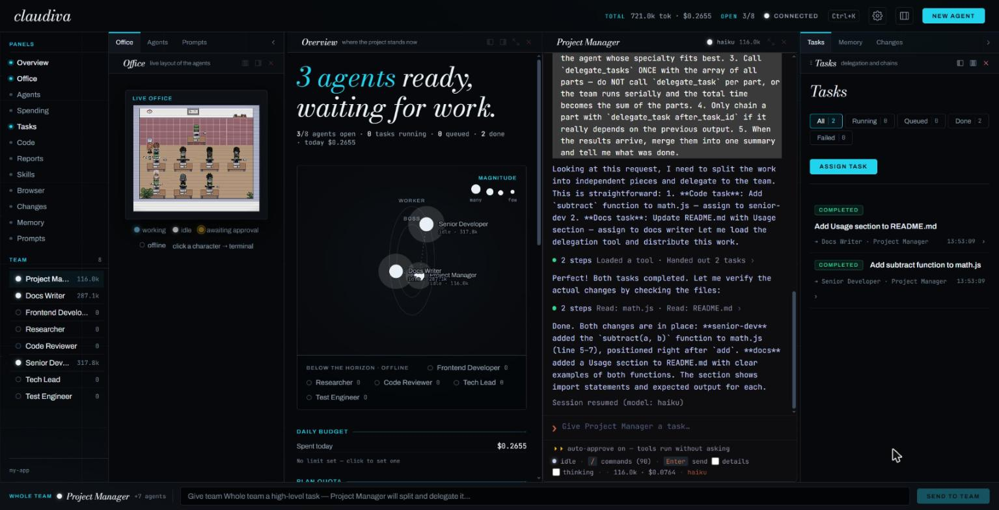
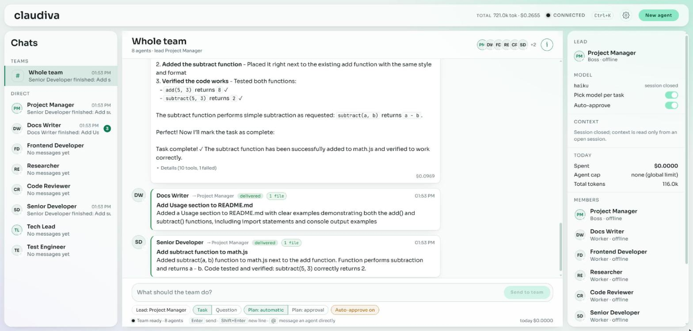
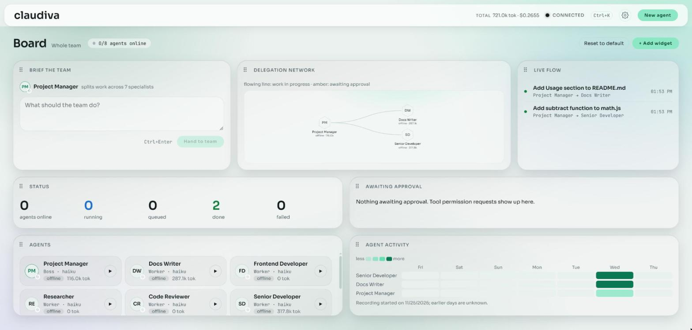
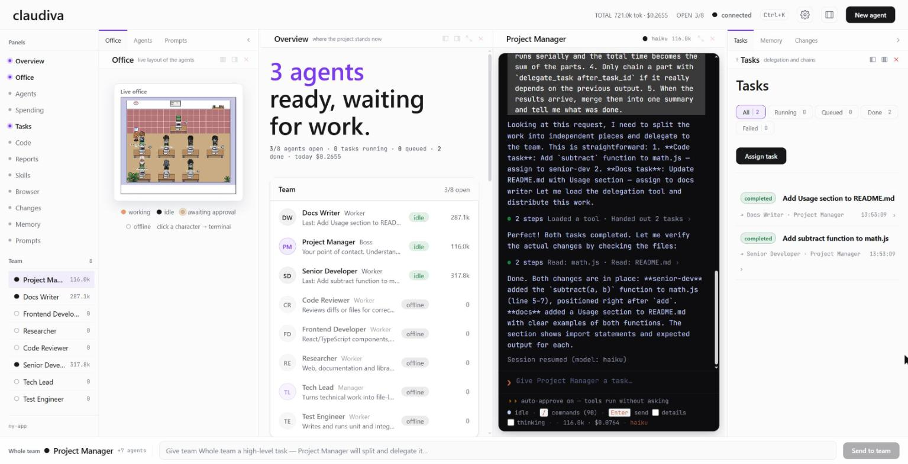
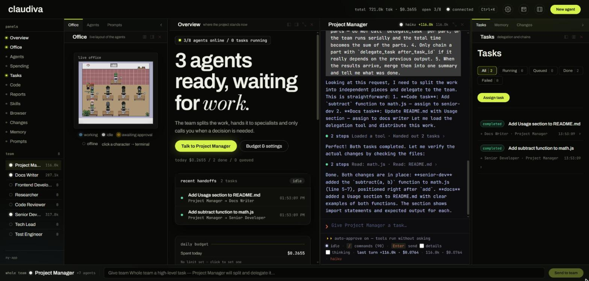

<div align="center">

**English** · [Türkçe](README.tr.md)

# 🔭 Claudiva

### Run, watch and coordinate several Claude agents from one panel

Open two `claude` sessions in a terminal and each one is on its own: they can't
see what the other is doing, can't hand each other work, and you can't tell what
they spent. **Claudiva** puts them all on one screen. The agents work in your
project folder; the panel shows who did what, which files they touched and what
it cost.

[](https://www.npmjs.com/package/claudiva)
[](https://www.npmjs.com/package/claudiva)


[Install](#-install) · [Usage](#-usage) · [Three ways to work](#-three-ways-to-work) · [Panels](#-panels) · [Team](#-team-and-delegation) · [Appearance](#-appearance-and-language) · [Development](#-development)

</div>



---

## 📦 Install

You need:

- [Node.js 20+](https://nodejs.org)
- [Claude Code](https://claude.com/product/claude-code) installed and signed in
  (`claude login`). The Agent SDK uses your subscription; no separate API key
  is needed.

**To try it**, without installing anything:

```bash
npx claudiva
```

**For everyday use**, so the `claudiva` command works everywhere:

```bash
npm install -g claudiva
```

To update: `npm install -g claudiva@latest`. With npx use
`npx claudiva@latest`, otherwise npx may run an older cached version.

<details>
<summary><b>Install from source</b> (for development)</summary>

```bash
git clone https://github.com/Serdarsahinn05/claudiva.git
cd claudiva
npm install
npm run build
npm link          # points the `claudiva` command at this folder
```

`npm link` points the `claudiva` command at this folder instead of the published
release, so your changes run directly after `npm run build`. Don't use it
together with a global install; both want the same command name. To go back:
`npm rm -g claudiva`, then `npm install -g claudiva`.

</details>

## ▶️ Usage

Run it **in the folder** of the project you want to work on:

```bash
cd ~/projects/my-app
claudiva
```

The panel opens in your browser (http://localhost:4600 by default) and the
agents work directly in that folder: they read, edit and create files there.

| Option | Description |
|---|---|
| `--dir <path>` | Run in another directory (default: the current one) |
| `--port <n>` | Server port (default: 4600) |
| `--no-open` | Don't open the browser |

If the port is taken and you didn't pass `--port`, it moves to the next free one.

### The first five minutes

The first run sets up an eight-agent team for you (see [Directories](#-directories)).

1. Write what you want in the box at the bottom (**Send to team**). The
   **Project Manager** splits the request into independent parts, hands them out
   in parallel and merges the results into one report.
2. Tool permission requests appear in the panel as a yellow band; approve or
   deny them. You can turn on auto-approve for agents you trust.
3. Want to see the plan before anything is handed out? Pick **Plan: approval**:
   the lead writes the plan and waits for your go-ahead.
4. Add your own agents with **New agent**. Fill in the "Description" field; the
   lead reads it when deciding who gets which part.

---

## 🧭 Three ways to work

The same team and the same data, shown three ways. Switch under Settings →
Interface or from the command palette (`Ctrl+K`).

| Mode | Best for |
|---|---|
| **Panels** | Multi-panel workspace: terminals, task board, code and spending side by side |
| **Chat** | The team as a group chat: agents hand work to each other, you step in with `@agent` |
| **Board** | A customizable widget board: add, drag and resize cards |



In **Chat**, every delivery card shows how many files the agent actually wrote,
measured rather than claimed. You can reply to a message (WhatsApp-style quote),
message an agent directly, and switch between **Task** and **Question**.



---

## 🖥 Panels

In Panels mode there are no tabs; there are **three slots**: a column on the
left, one on the right and a tiled work area in the middle. Drag panels to the
slot you want; the layout is saved in your browser. The middle area is for
terminals: every open agent gets its own tile and all of them stay visible.

| Panel | What it shows |
|---|---|
| **Overview** | Where the project stands right now; the opening screen |
| **Office** | A live office of the agents; each character moves by its real status |
| **Agents** | Team directory: add, edit, start and stop agents |
| **Spending** | Tokens and cost over time, per agent and per model |
| **Tasks** | Delegation, dependency chains, results |
| **Code** | Project tree and file contents, syntax-highlighted, read-only |
| **Reports** | The agent's *claim* next to the *measurement*: what it said and which files it really touched |
| **Skills** | Enable, disable or remove installed skills; search repositories and install in bulk |
| **Browser** | A browser on the server; you see the page an agent is driving |
| **Changes** | File diffs and revert |
| **Memory** | A map of agent memory (with `[[link]]` relations) |
| **Prompts** | Saved templates, sent with one click |

### Code panel

It answers a different question than the Changes panel: Changes shows what is
different since the last commit, Code shows the codebase itself. Syntax
highlighting is loaded lazily (zero bytes until the panel opens), and file-type
icons are served one by one from the server, so they never enter the browser
bundle. A **who touched it** badge sits on top of each file and stays after the
file is committed.

There is deliberately no write endpoint: the only one that changes files is an
agent, and it goes through the permission gate.

### Reports panel

Shows whether an agent that says "done" actually did something. The files
written for the task are listed next to its result; if none were touched, the
badge says so. For delegated work, the subtasks' writes are collected under the
parent task.

### Skills panel

Two modes. **Installed** manages the skills on disk: disabling doesn't delete
anything, `SKILL.md` is renamed and can be turned back on. **Discover** searches
GitHub repositories: tick the ones you want and install them in bulk; the scope
is asked once. You can add your own repository to the built-in sources.

### Browser panel

A Chromium runs on the server, and both you and the agents drive the same
browser. You see the page an agent opened and can take over. Every browser
action an agent takes goes through the normal permission gate.

Chromium is downloaded separately (so the package isn't ~1 GB, full Playwright
is not installed):

```bash
npx playwright-core install chromium
```

Without it the server still runs; only this panel says "not installed".

---

## 👥 Team and delegation

There are four roles: `boss`, `manager`, `team-leader` and `worker`. The first
three can delegate; `worker` can't. That isn't a setting: that role simply never
gets the delegation tools.

Delegation is **truly parallel**: a set of tasks starts all at once, so the wall
clock is as long as the longest task, not the sum of them. Validation comes
first: if one target is invalid, nothing is handed out, so "I gave it to N
agents" never silently breaks.

Tasks can be chained: a step waits for the result of the previous one. If a step
fails, the next one fails too instead of running on missing input and producing
a misleading result.

**A task closes when the agent says so, not by counting turns.** A message and a
result don't map one to one (background notifications can start a turn with no
message, and a message sent mid-turn is absorbed into that turn), so the agent
reports completion with `complete_task`. As a fallback, tasks still open 90
seconds after the last turn are closed with a note on the result.

Teams are not kept in a separate registry; they come from each agent's `team`
field. Typing a new name creates a team; moving its last agent removes it. The
team picker is a **scope** picker, not a section: it doesn't change the open
panels, it changes whom they show.

### Model router (experimental, off by default)

When turned on (Settings → Budget), each task is routed to a cheaper or stronger
model by its size: a rule layer decides first at no cost, and only when unsure a
one-word Haiku classifier is asked. Savings on small tasks were measured, but
they are not guaranteed and work sent to the cheaper model may lose quality.
Decisions and measured savings appear under Spending → Model router.

---

## 📁 Directories

The team is **global**, the data is **per project**. The same team is ready in
every project, but tasks and memory don't mix between projects; the same agent
runs a separate session in each one.

> The folders used to be called `.claude-manager`. An old install is moved to
> `.claudiva` once on startup (agents, tasks and memory are kept). If the folder
> is locked at that moment (an old server still running), it keeps working under
> the old name.

**`~/.claudiva/`**, shared by all projects

| Directory | Contents |
|---|---|
| `agents/<id>/` | `config.json`, `personality.md`, `skills/<name>/SKILL.md` |

On first run the default eight-agent team is copied here (boss, tech-lead,
senior-dev, frontend-dev, reviewer, tester, researcher, docs). Your later edits
are kept across updates.

**`<project>/.claudiva/`**, specific to that project and kept out of git

| Directory | Contents |
|---|---|
| `memory/` | Obsidian-compatible memory (shared + per agent) |
| `data/` | Token counts, task history, sessions, transcripts, changes |
| `prompts/` | Prompt library |

## 🧩 Skills and commands

Each agent directory is also a local Claude Code plugin; the
`skills/<name>/SKILL.md` files inside it are called as `/<name>` in the
terminal. Your own skills and plugins under `~/.claude/skills` work too; type `/`
in the terminal to list them all.

The panel's terminal uses the real CLI's command set. Commands that open a
screen in the CLI, like `/status`, `/context`, `/usage`, `/model`, `/agents` and
`/mcp`, are drawn by the panel on its own surfaces; everything else goes to the
agent as it is. The panel never rejects a command.

## 🎨 Appearance and language

Style and colour are two separate axes, both picked from the **Appearance** menu.

| Style | Feel | Palettes |
|---|---|---|
| **Observatory** (default) | A star atlas: engraved headings, paper grain, a starfield | Obsidian (default), Carbon, Aurora, Night, Day |
| **Studio** | A clean product surface: sans-serif, soft corners, no texture | Paper, Graphite |
| **Phosphor** | A midnight product page: bold headings, italic serif accents, lime light | Phosphor |

<table>
<tr>
<td width="50%"></td>
<td width="50%"></td>
</tr>
<tr>
<td align="center"><sub>Studio · Paper</sub></td>
<td align="center"><sub>Phosphor</sub></td>
</tr>
</table>

Contrast isn't approved by eye, it is measured: `node web/scripts/contrast.mjs`
checks every palette against the thresholds and exits non-zero if one fails.

The interface is available in **English** and **Turkish** (Settings → Interface,
or `Ctrl+K` → "Change language"); the first visit follows your browser's
language. The built-in agents' names and descriptions follow the interface
language too; a name you set yourself stays as you typed it. Agents reply in
the language you write in.

---

## 🧰 Built with

| Layer | Stack |
|---|---|
| **Agents** | [Claude Agent SDK](https://docs.claude.com/en/api/agent-sdk/overview) on your Claude Code subscription. Delegation, task completion, model choice and browser tools are in-process **MCP** servers with `zod` schemas. |
| **Server** | **Node.js** + **Express** for HTTP, a one-way **WebSocket** broadcast keeps the panel live, **playwright-core** + Chromium for the Browser panel. |
| **Interface** | **React 19** + **Vite**. No UI library: hand-written CSS with channel tokens, lazily loaded panels, syntax highlighting with **Prism**. |

The repository is an npm workspace: `server/` and `web/`. Checks: `oxlint` and
our own contrast-measuring script.

## 🛠 Development

```bash
npm run dev       # panel http://localhost:5173, API http://localhost:4600
npm run build     # the only valid way to verify
```

Repository layout:

| Path | Contents |
|---|---|
| `server/src/agents/` | Session, provider interface (`AgentBackend`), usage history |
| `server/src/tasks/` | Task queue, chains, the `complete_task` tool |
| `server/src/router/` | The opt-in model router (rules + classifier) |
| `server/src/api/` | HTTP endpoints (`routes.ts`) |
| `server/src/ws.ts` | One-way WebSocket broadcast that keeps the panel live |
| `web/src/components/` | Panels (one file each), `chat/` and `board/` modes |
| `web/src/i18n/` | Interface dictionaries (`tr.ts` is the source, `en.ts` is type-checked against it) |
| `web/src/workspace.ts` | The shape of the layout; `useLayout.ts` is the only place that changes it |
| `agents/` | The default team copied on first run |
| `bin/claudiva.js` | CLI; runs `server/dist` |

Adding a panel takes two lines: an entry in the registry in `workspace.ts` and a
`case` in `renderPanel()` in `App.tsx`.

A few notes, all learned by measuring:

- **Always verify with `npm run build`.** The CLI runs `server/dist`, not the
  source, and `web/tsconfig.json` is a solution file, so `tsc --noEmit` checks
  nothing on the web side.
- Stop the server **by port**, not by age, and confirm the port is free; a
  surviving old process can leave you talking to the old server without noticing.
- Editing the JSON files under `data/` **while the server runs** does nothing;
  the stores only read them at startup.

Architecture decisions and pitfalls are in `CLAUDE.md` (plus `server/CLAUDE.md`
and `web/CLAUDE.md`), product decisions in `PRODUCT.md`, the visual authority in
`web/DESIGN.md`. Publishing to npm, bumping versions and the difference between
`npx`, a global install and `npm link`: [`docs/YAYIN.md`](docs/YAYIN.md). These
developer notes are written in Turkish.

## ⚠️ Known limits

- The provider layer is abstracted (`AgentBackend`), but **there is one provider
  today**: Claude. That's a recorded state, not a gap.
- The Browser panel needs Chromium downloaded separately (see above).
- An agent has to load the `complete_task` tool with `ToolSearch` before calling
  it; that costs an extra turn but doesn't break anything.

## ✨ How it was written

This project was **vibe coded**: the code was written largely with Claude, by
conversation. The wanted behavior was described, the result was tried in the
panel, and what didn't hold up was rewritten.

That has a consequence I'm not trying to hide: the reasons behind decisions were
written into documents, not into the code. Most notes in `CLAUDE.md` aren't
guesses but wrong assumptions corrected by measurement; which approach was tried
and why it was dropped is recorded there too. Reading the relevant note before
changing something is the shortest way not to fall into the same trap twice.

## 🙏 Thanks

The Office panel's artwork comes from
[pixel-agents](https://github.com/pixel-agents-hq/pixel-agents) (MIT); the
characters are based on the
[JIK-A-4 "MetroCity"](https://jik-a-4.itch.io/metrocity-free-topdown-character-pack)
pack. File-type icons from
[Material Icon Theme](https://github.com/material-extensions/vscode-material-icon-theme)
(MIT). Syntax highlighting by [Prism](https://prismjs.com). Fonts are bundled
via [Fontsource](https://fontsource.org), so it looks the same offline.

## 📄 License

[MIT](LICENSE)

Claudiva is an independent open-source project. It is not affiliated with,
endorsed by or sponsored by Anthropic. "Claude" and "Claude Code" belong to
Anthropic PBC and appear here only to describe compatibility.
