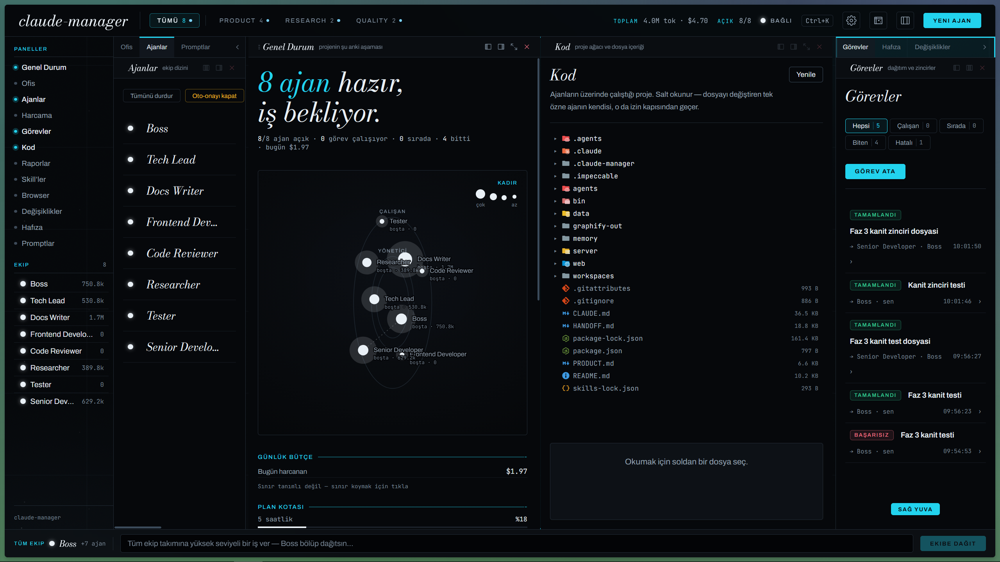

<div align="center">

# 🔭 Claudiva

### Birden fazla Claude ajanını tek panelden çalıştır, izle ve koordine et

Terminalde iki ayrı `claude` açtığınızda ikisi de kendi başınadır: ne
yaptıklarını göremez, birbirlerine iş veremez, ne harcadıklarını bilemezsiniz.
**Claudiva** hepsini tek ekrana toplar — ajanlar sizin proje klasörünüzde
çalışır, panel kim ne yaptı, neye dokundu, ne harcadı hepsini gösterir.

[](https://www.npmjs.com/package/claudiva)
[](https://www.npmjs.com/package/claudiva)


[Teknolojiler](#-teknolojiler) · [Kurulum](#-kurulum) · [Kullanım](#-kullanım) · [Panel](#-panel) · [Ekip](#-ekip-ve-delegasyon) · [Temalar](#-temalar) · [Geliştirme](#-geliştirme)

</div>



---

## 🧰 Teknolojiler

<table>
<tr>
<td width="33%" valign="top">

### 🤖 Ajan katmanı


Ajanlar **Agent SDK** ile, sizin Claude Code aboneliğinizle koşar.
Delegasyon, görev bildirimi, model seçimi ve tarayıcı araçları
süreç içi **MCP** sunucularıdır — şemaları `zod` ile.

</td>
<td width="33%" valign="top">

### ⚙️ Sunucu


**Express** HTTP uçlarını, tek yönlü bir **WebSocket** yayını paneli canlı
tutar. Browser paneli için **playwright-core** + Chromium.

</td>
<td width="33%" valign="top">

### 🖥 Arayüz


**React 19 + Vite.** UI kütüphanesi yok: stil elle yazılmış CSS, renkler kanal
token'ı. Sözdizimi renklendirme **Prism** ile ve tembel yüklenir.

</td>
</tr>
</table>

<div align="center">

**Yazı tipleri** [Fontsource](https://fontsource.org) ile paketten gelir (çevrimdışı da aynı görünür) ·
**Dosya ikonları** [Material Icon Theme](https://github.com/material-extensions/vscode-material-icon-theme) ·
**Denetim** `oxlint` + kendi kontrast ölçüm betiğimiz

Depo bir npm workspace'idir: `server/` ve `web/`.

</div>

---

## 📦 Kurulum

Gerekenler:

- [Node.js 20+](https://nodejs.org)
- [Claude Code](https://claude.com/product/claude-code) kurulu ve giriş yapılmış
  (`claude login`). Agent SDK aboneliğinizi kullanır; ayrı bir API anahtarı
  gerekmez.

**Denemek için** — hiçbir şey kurmaz, doğrudan çalıştırır:

```bash
npx claudiva
```

**Sürekli kullanacaksanız** — `claudiva` komutu her yerde tanınır:

```bash
npm install -g claudiva
```

Güncelleme: `npm install -g claudiva@latest` (npx kullanıyorsanız
`npx claudiva@latest`, yoksa npx önbellekteki eski sürümü çalıştırabilir).

<details>
<summary><b>Kaynaktan kurulum</b> (geliştirme için)</summary>

```bash
git clone https://github.com/Serdarsahinn05/claudiva.git
cd claudiva
npm install
npm run build
npm link          # `claudiva` komutunu yerel klasöre bağlar
```

`npm link`, `claudiva` komutunu yayınlanan sürüme değil bu klasöre bağlar — yani
kodda yaptığınız değişiklik (`npm run build` sonrası) doğrudan çalışır. Global
kurulum ile aynı anda kullanmayın, ikisi aynı komut adını ister; geri dönmek için
`npm rm -g claudiva` sonra `npm install -g claudiva`.

</details>

## ▶️ Kullanım

Hangi projede çalışacaksanız **o klasörde** çalıştırın:

```bash
cd D:/YeniProjem
claudiva
```

Panel tarayıcıda açılır (varsayılan http://localhost:4600) ve ajanlar doğrudan o
klasörde çalışır — dosyaları orada okur, düzenler, oluşturur.

| Seçenek | Açıklama |
|---|---|
| `--dir <yol>` | Başka bir dizinde çalıştır (varsayılan: bulunduğunuz dizin) |
| `--port <no>` | Sunucu portu (varsayılan: 4600) |
| `--no-open` | Tarayıcıyı otomatik açma |

Port doluysa ve `--port` vermediyseniz bir sonraki boş porta kayar.

### İlk beş dakika

1. **Yeni Ajan** ile bir **patron** oluşturun (model: Sonnet ya da Opus).
2. Birkaç **çalışan** ekleyin (model: Haiku ya da Sonnet). "Açıklama" alanını
   doldurun — patron işi dağıtırken bu metni okur.
3. Patronun terminaline ne istediğinizi yazın. İşi kendisi böler, ekibe dağıtır,
   sonuçları toplar. Ya da **Görevler** panelinden doğrudan atayın.
4. Araç izin istekleri panele sarı bant olarak düşer; onaylayın ya da reddedin.
   Güvendiğiniz ajanlarda otomatik onayı açabilirsiniz.

---

## 🖥 Panel

Sekme yoktur; **üç yuva** vardır — solda ve sağda birer sütun, ortada döşenmiş
bir çalışma alanı. Panelleri sürükleyerek istediğiniz yuvaya taşırsınız,
yerleşim tarayıcıda saklanır. Ortadaki alan terminaller içindir: her açık ajan
kendi gözünü alır, hepsi aynı anda görünür.

| Panel | Ne gösterir |
|---|---|
| **Genel Durum** | Projenin şu anki aşaması — açılış ekranı |
| **Ofis** | Ajanların canlı yerleşimi; her karakter gerçek duruma göre hareket eder |
| **Ajanlar** | Ekip dizini; ajan ekleme, düzenleme, başlatma/durdurma |
| **Harcama** | Token ve maliyet dökümü: zaman içinde, ajan başına, model başına |
| **Görevler** | Dağıtım, bağımlılık zincirleri, sonuçlar |
| **Kod** | Proje ağacı ve dosya içeriği — sözdizimi renkli, salt okunur |
| **Raporlar** | Ajanın *iddiası* ile *ölçümü* yan yana: ne dediği ve hangi dosyalara gerçekten dokunduğu |
| **Skill'ler** | Kurulu skill'leri aç/kapat/sil; depolarda ara ve toplu kur |
| **Browser** | Sunucudaki tarayıcı — ajanların sürdüğü sayfayı siz de görürsünüz |
| **Değişiklikler** | Dosya farkları, geri alma |
| **Hafıza** | Ajan hafıza haritası (`[[link]]` ilişkileriyle) |
| **Promptlar** | Kayıtlı şablonlar, tek tıkla gönderim |

### Kod paneli

Değişiklikler panelinden farklı bir soruyu yanıtlar: o "son commit'e göre ne
farklı"yı gösterir, bu ise kod tabanının kendisini. Sözdizimi renklendirme
tembel yüklenir (panel açılmadan sıfır bayt), dosya türü ikonları sunucudan tek
tek servis edilir — tarayıcı paketine hiç girmezler. Dosyanın üstünde ayrıca
**kim dokundu** rozeti durur; commit'lenmiş dosyada da kalır.

Yazma ucu bilerek yoktur: dosyayı değiştiren tek özne ajandır ve o izin
kapısından geçer.

### Raporlar paneli

"Bitirdim" diyen bir ajanın gerçekten bir şey yapıp yapmadığını gösterir. Görev
sonucunun yanında o işte yazılan dosyalar listelenir; hiçbirine dokunulmadıysa
rozet bunu söyler. Delege edilen işlerde alt görevlerin dokunuşları da üst işin
altında toplanır.

### Skill'ler paneli

İki kip vardır. **Kurulu** kipi diskteki skill'leri yönetir — kapatmak dosyayı
silmez, `SKILL.md` yeniden adlandırılır ve istediğinizde geri açılır. **Keşfet**
kipi GitHub depolarında arama yapar: işaretleyip toplu kurarsınız, kapsam bir kez
sorulur. Yerleşik kaynaklara kendi deponuzu ekleyebilirsiniz.

### Browser paneli

Sunucuda bir Chromium çalışır; hem siz hem ajanlar aynı tarayıcıyı sürer.
Ajanın açtığı sayfayı panelde görür ve devralırsınız. Ajanın her tarayıcı eylemi
normal izin kapısından geçer.

Chromium ayrı indirilir (paket ~1 GB olmasın diye tam Playwright kurulmaz):

```bash
npx playwright-core install chromium
```

Kurmazsanız sunucu yine çalışır, yalnız bu panel "kurulu değil" der.

---

## 👥 Ekip ve delegasyon

Dört rol vardır: `boss`, `manager`, `team-leader`, `worker`. İlk üçü iş
dağıtabilir; `worker` dağıtamaz — bu bir ayar değil, o role delegasyon araçları
hiç verilmez.

Dağıtım **gerçekten paralel** çalışır: bir dizi görev hepsi birden başlatılır,
duvar saati en uzun görev kadardır, görevlerin toplamı kadar değil. Doğrulama
önce yapılır — hedeflerden biri geçersizse hiçbiri dağıtılmaz, "N ajana verdim"
beklentisi sessizce bozulmaz.

Görevler zincirlenebilir: bir adım bir öncekinin sonucunu bekler. Bir adım
başarısız olursa sonraki de başarısız sayılır; eksik girdiyle çalışıp yanıltıcı
sonuç üretmez.

**Görev kapanışı tur sayarak değil, ajanın kendi bildirimiyle olur.** Bir mesaj
ile bir sonuç birebir eşleşmez (arka plan bildirimleri mesajsız tur doğurabilir,
tur sürerken gelen mesaj o turun içine emilir), bu yüzden ajan bitirdiğini
`complete_task` ile söyler. Yedek olarak son turdan 90 saniye sonra hâlâ açık
görevler kapatılır ve sonuca not düşülür.

Takımlar ayrı bir kayıt defterinde tutulmaz; ajanların `team` alanından türer.
Yeni bir ad yazmak takımı var eder, son ajanı taşımak yok eder. Takım seçici bir
bölüm değil **kapsam** seçicisidir: açık panelleri değiştirmez, hepsinin kimi
gösterdiğini değiştirir.

---

## 📁 Dizinler

Ekip **global**, veri **proje başına**. Aynı ajan ekibi her projede hazır gelir
ama görevler ve hafıza projelere karışmaz; aynı ajan iki projede ayrı oturum
yürütür.

> Disk üzerindeki klasör adı `.claude-manager` olarak kaldı (projenin eski adı).
> Adı değiştirmek mevcut kurulumlardaki ajanları, görevleri ve hafızayı görünmez
> yapardı; bu bir yeniden adlandırma değil taşıma işi olurdu.

**`~/.claude-manager/`** — bütün projelerde ortak

| Dizin | İçerik |
|---|---|
| `agents/<id>/` | `config.json`, `personality.md`, `skills/<ad>/SKILL.md` |

İlk çalıştırmada varsayılan 8 ajanlık ekip buraya kopyalanır (boss, tech-lead,
senior-dev, frontend-dev, reviewer, tester, researcher, docs). Sonradan
yaptığınız düzenlemeler güncellemelerde korunur.

**`<proje>/.claude-manager/`** — o projeye özel, git'e girmez

| Dizin | İçerik |
|---|---|
| `memory/` | Obsidian uyumlu hafıza (ortak + ajan başına) |
| `data/` | Token sayımı, görev geçmişi, oturumlar, döküm, değişiklikler |
| `prompts/` | Prompt kütüphanesi |

## 🧩 Skill'ler

Her ajan dizini aynı zamanda yerel bir Claude Code plugin'idir; içindeki
`skills/<ad>/SKILL.md` dosyaları terminalde `/<ad>` olarak çağrılır. Kendi
`~/.claude/skills` altındaki skill'leriniz ve plugin'leriniz de geçerlidir —
terminalde `/` yazınca hepsi listelenir.

Panelin terminali gerçek CLI'ın komut setini kullanır. `/status`, `/context`,
`/usage`, `/model`, `/agents`, `/mcp` gibi CLI'da ekran açan komutlar panelde
kendi yüzeyleriyle çizilir; geri kalan her şey olduğu gibi ajana gider. Panel
hiçbir komutu reddetmez.

## 🎨 Temalar

Altı tema iki aileden gelir. **Plakalar** bir gözlem koşulunu taklit eder:
*Gece*, *Kırmızı Fener* (gece görüşünü bozmaz — mavi yoktur, durumlar renkle
değil parlaklık ve biçimle ayrışır), *Gündüz* (basılı kağıt). **Premium** ise
işlenmiş bir yüzeydir: *Obsidyen* (varsayılan), *Karbon*, *Aurora*.

Kontrast göz kararıyla onaylanmaz, ölçülür: `node web/scripts/contrast.mjs`
altı plakayı da eşiklere karşı sınar ve tutmuyorsa sıfırdan farklı çıkar.

---

## 🛠 Geliştirme

```bash
npm run dev       # panel http://localhost:5173, API http://localhost:4600
npm run build     # doğrulamanın tek geçerli yolu
```

Depo düzeni:

| Yol | İçerik |
|---|---|
| `server/src/agents/` | Oturum, sağlayıcı arkayüzü (`AgentBackend`), kullanım geçmişi |
| `server/src/tasks/` | Görev kuyruğu, zincirler, `complete_task` aracı |
| `server/src/api/` | HTTP uçları (`routes.ts`) |
| `server/src/ws.ts` | Tek yönlü WebSocket yayını — panel buradan canlı kalır |
| `web/src/components/` | Paneller (her biri bir dosya) |
| `web/src/workspace.ts` | Yerleşimin şekli; `useLayout.ts` onu değiştiren tek yer |
| `agents/` | İlk çalıştırmada kopyalanan varsayılan ekip |
| `bin/claudiva.js` | CLI — `server/dist`i çalıştırır |

Yeni panel eklemek iki satırdır: `workspace.ts` içindeki kayda bir giriş,
`App.tsx` içindeki `renderPanel()`e bir `case`.

Birkaç not, hepsi ölçülerek öğrenildi:

- **Doğrulama daima `npm run build`.** CLI kaynağı değil `server/dist`i
  çalıştırır, ayrıca `web/tsconfig.json` bir çözüm dosyasıdır — `tsc --noEmit`
  web tarafında hiçbir şeyi denetlemez.
- Sunucuyu yaşına göre değil **porta göre** durdurun ve portun boşaldığını
  doğrulayın; hayatta kalan eski bir süreç yüzünden farkında olmadan eski
  sunucuyla konuşabilirsiniz.
- `data/` altındaki JSON dosyalarını sunucu **çalışırken** elle düzenlemek işe
  yaramaz; store'lar dosyayı yalnızca açılışta okur.

Mimari kararlar ve tuzaklar `CLAUDE.md`, ürün kararları `PRODUCT.md`, görsel
otorite `web/DESIGN.md` içinde. npm'e yayınlama, sürüm yükseltme ve
`npx` / global kurulum / `npm link` farkı: [`docs/YAYIN.md`](docs/YAYIN.md).

## ⚠️ Bilinen sınırlar

- Sağlayıcı katmanı soyutlanmıştır (`AgentBackend`) ama **şu an tek sağlayıcı
  vardır**: Claude. Bu bir eksiklik değil, kayıtlı bir durumdur.
- Browser paneli için Chromium'u ayrıca indirmeniz gerekir (yukarıya bakın).
- Ajan `complete_task` aracını çağırmadan önce `ToolSearch` ile yüklemek zorunda
  kalıyor; fazladan bir tur maliyeti var, işlevi bozmuyor.

## ✨ Nasıl yazıldı

Bu proje **vibe coding** ile yazıldı: kod büyük ölçüde Claude ile, konuşarak
üretildi — istenen davranış tarif edildi, çıkan sonuç panelde denendi, tutmayan
yer yeniden yazıldı.

Bunun bir sonucu var ve gizlemeye çalışmıyorum: kararların gerekçesi koda değil
belgelere yazıldı. `CLAUDE.md` içindeki notların çoğu bir tahmin değil, yanlış
çıkmış bir varsayımın ölçülerek düzeltilmiş hâlidir — hangi yaklaşımın denenip
neden elendiği de orada durur. Bir şeyi değiştirmeden önce ilgili notu okumak,
aynı tuzağa ikinci kez düşmemenin en kısa yolu.

## 🙏 Teşekkür

Ofis panelinin görselleri [pixel-agents](https://github.com/pixel-agents-hq/pixel-agents)
(MIT) projesinden; karakterler [JIK-A-4 "MetroCity"](https://jik-a-4.itch.io/metrocity-free-topdown-character-pack)
paketi tabanlıdır. Dosya türü ikonları
[Material Icon Theme](https://github.com/material-extensions/vscode-material-icon-theme)
(MIT). Sözdizimi renklendirme [Prism](https://prismjs.com) ile yapılır.

## 📄 Lisans

[MIT](LICENSE)

Claudiva bağımsız bir açık kaynak projedir; Anthropic ile bir bağı yoktur,
Anthropic tarafından desteklenmez veya onaylanmaz. "Claude" ve "Claude Code",
Anthropic PBC'ye aittir ve burada yalnızca uyumluluğu tarif etmek için geçer.
